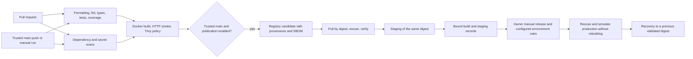

# Enterprise CI/CD Pipeline

[](https://github.com/gig0d/enterprise-cicd-pipeline/actions/workflows/ci.yml)

A DevOps portfolio project demonstrating how a small Python service moves through blocking quality gates, security scans, reproducible container builds, immutable artifact publication, ephemeral staging, controlled release, and recovery verification.

The service is deliberately small. The engineering focus is the delivery system: trustworthy inputs, least-privilege automation, traceable artifacts, meaningful failure behavior, and evidence that distinguishes implemented controls from observed execution.

**Owner:** Giovanny Alvarado Barrantes · **Repository:** [gig0d/enterprise-cicd-pipeline](https://github.com/gig0d/enterprise-cicd-pipeline)

## Delivery architecture



PRs run without publishing credentials. Trusted `main` runs can publish `ghcr.io/gig0d/enterprise-cicd-pipeline:<source-sha>` after the required gates pass. The delivery candidate is then identified by digest throughout staging, release, and recovery. The preliminary PR-compatible Docker build is a validation build.

## Implemented controls

| Area | Implementation |
| --- | --- |
| Quality | Ruff format/lint, strict MyPy, unit and HTTP integration tests, 90% application branch-coverage gate, locked package build |
| Containers | Digest-pinned official Python base, hashed binary dependencies, multi-stage installation, non-root runtime, no runtime pip, read-only filesystem and resource limits |
| Security | pip-audit of runtime and development dependencies, full-history Gitleaks, Trivy, exact expiring exceptions, immutable external Action references |
| Traceability | Source-SHA tag, OCI labels, registry digest, workflow run/attempt, timestamp, version, test reports, BuildKit provenance and SPDX SBOM |
| Staging | Same-digest pull, actual readiness, HTTP checks, revision/version verification, clean shutdown, diagnostics, cleanup |
| Release | Owner-only manual dispatch, successful CI and staging verification, artifact checksums, seven-day evidence limit, fresh image scan, isolated production simulation |
| Promotion and recovery | Optional explicit semantic tagging without rebuild or tag overwrite; optional GitHub draft release requiring an owner-created annotated Git tag; two-digest rollback demonstration |

Observed executions and candidate records are in [verification evidence](docs/verification.md). Branch protection and production reviewer rules are separate settings; see [GitHub setup](docs/github-setup.md). Manual dispatch alone is not a GitHub-enforced reviewer gate.

## Small application, meaningful health checks

| Endpoint | Behavior |
| --- | --- |
| `GET /health/live` | Lightweight process liveness |
| `GET /health/ready` | Checks the actual process-local inventory store; 503 when unavailable |
| `GET /api/v1/info` | Safe name, version, environment, and optional build identifier |
| `GET /api/v1/items` | Deterministic seed inventory followed by created items |
| `POST /api/v1/items` | Validated creation (201), duplicate SKU (409), invalid input (422) |
| `GET /docs` | Interactive OpenAPI documentation |

The thread-safe in-memory store resets on restart. Run one worker: stores are not shared across processes or replicas. There is no database, authentication system, or durable inventory recovery. Decimal prices, bounded quantities, SKU validation, structured errors, and JSON request logs keep the example useful without expanding its business scope.

## Run locally on Windows

Install [Python 3.13](https://www.python.org/downloads/) and Git. From PowerShell:

```powershell
git clone https://github.com/gig0d/enterprise-cicd-pipeline.git
Set-Location enterprise-cicd-pipeline
python --version
python -m pip install --require-hashes -r .github/requirements-bootstrap.txt
uv sync --locked
$env:APP_ENVIRONMENT = 'development'
uv run uvicorn pipeline_demo_api.main:app --host 127.0.0.1 --port 8000 --no-access-log
```

Use a Python 3.13 interpreter for bootstrap. Open http://127.0.0.1:8000/docs. In another PowerShell terminal:

```powershell
Invoke-RestMethod http://127.0.0.1:8000/health/ready
$item = @{sku='LOCAL-001'; name='Demo adapter'; quantity=2; unit_price='12.50'} | ConvertTo-Json
Invoke-RestMethod -Method Post -Uri http://127.0.0.1:8000/api/v1/items -ContentType 'application/json' -Body $item
```

Configuration comes from process environment variables; `.env` files are not automatically loaded:

| Variable | Default | Validation |
| --- | --- | --- |
| `APP_ENVIRONMENT` | `development` (container: `production`) | `development`, `test`, `staging`, `production` |
| `APP_VERSION` | `0.1.0` | Semantic application version |
| `APP_BUILD_ID` | unset (container: embedded source revision) | Safe identifier, at most 128 characters |
| `APP_LOG_LEVEL` | `INFO` | `DEBUG`, `INFO`, `WARNING`, `ERROR` |

Invalid configuration fails startup. Container verification checks the embedded revision instead of overriding it at deployment.

## Validate and build

```powershell
uv run ruff format --check .
uv run ruff check .
uv run mypy
uv run python -m scripts.check_repository
uv run pytest --cov --cov-report=term-missing --cov-report=xml
uv run python -m build --no-isolation
uv run python -m scripts.install_tool actionlint
.\.tools\actionlint\actionlint.exe
```

The lock includes the exact build backend and its dependencies. `requirements.txt` is the hashed production export; CI rejects drift. Native scanner and workflow-validation downloads are checked against committed SHA-256 hashes. See [testing](docs/testing.md) for coverage scope and failure demonstrations.

Install and start Docker Desktop with Linux containers for local verification:

```powershell
$revision = git rev-parse HEAD
docker build --build-arg "VCS_REF=$revision" -t pipeline-demo-api:local .
uv run python -m scripts.container_smoke --image pipeline-demo-api:local --revision $revision --environment staging
docker compose up --build --wait
docker compose down
```

Smoke tests start a fresh container on a random loopback port, exercise HTTP behavior, check clean shutdown, and remove resources. Compose supports interactive local use. No Make installation, cloud subscription, privileged container, or host filesystem mount is required.

## Workflows and documentation

| Workflow | Purpose |
| --- | --- |
| [`ci.yml`](.github/workflows/ci.yml) | PR/main/manual quality, security, container validation, trusted GHCR publication, staging |
| [`security.yml`](.github/workflows/security.yml) | Reusable dependency/secret gates and weekly read-only auditing |
| [`staging.yml`](.github/workflows/staging.yml) | Reusable staging verification by digest |
| [`release.yml`](.github/workflows/release.yml) | Owner-controlled simulation and separately requested tag/draft operations |
| [`rollback.yml`](.github/workflows/rollback.yml) | Readiness rejection and recovery to a different previously validated image |
| [`failure-demo.yml`](.github/workflows/failure-demo.yml) | Intentionally failed test/security gates with evidence of a skipped build |

Read [architecture](docs/architecture.md), [pipeline design](docs/pipeline-design.md), [security](docs/security.md), [deployment](docs/deployment.md), [release management](docs/release-management.md), [rollback](docs/rollback.md), [GitHub setup](docs/github-setup.md), [troubleshooting](docs/troubleshooting.md), and the [architecture decision](docs/adr/0001-delivery-platform.md).

## Limits and next steps

Staging, production, and recovery are ephemeral runner simulations with no persistent hosting or public service endpoint. Images target Linux amd64. Advisory, package, and registry services require network access. Old scan results do not remain valid indefinitely. BuildKit attestations are generated; independent signature-policy enforcement is a future improvement.

Production review and main-only environment restrictions were owner-authorized and verified through the API; `main` branch protection remains recommended and is not claimed active. Automatic version-update commits are disabled to preserve development authorship; the owner reviews dependency, Action, scanner, and base updates. Persistent deployment, durable data, multi-platform images, longer evidence retention, and signed artifact verification are future extensions.
