# Architecture

The delivery system is the focus of this repository. The application is one Python 3.13 FastAPI process with a thread-safe in-memory inventory. Its lifespan initializes the store and marks it unavailable on shutdown. Readiness reflects that dependency; liveness does not depend on it.

| Component | Responsibility | Boundary |
| --- | --- | --- |
| `src/pipeline_demo_api` | Validated configuration, schemas, inventory, health, errors, JSON logs | No authentication, external services, or database |
| `tests/unit` | Domain and delivery-policy behavior | Synthetic fixtures and mocked external APIs |
| `tests/integration` | FastAPI lifecycle and real loopback Uvicorn HTTP checks | No public business APIs |
| `scripts` | Bounded smoke checks, scanner policy, evidence validation, promotion, recovery | Portable Python commands; Docker/GitHub only where required |
| `.github/workflows` | Quality, security, build, staging, controlled release | Trusted publication separated from PR validation |
| GHCR | Source-tagged image indices identified by digest | Artifact registry, not application hosting |
| Artifacts/environments | Evidence retention and configurable policy boundaries | Not proof of active reviewer rules or persistent hosting |

Docker installs hashed binary dependencies in a builder and copies installed runtime dependencies plus application source into the runtime image. Runtime pip/bootstrap tooling is removed. UID/GID 10001 runs Uvicorn as PID 1 with bounded SIGTERM shutdown. Deployment scripts add filesystem, capability, resource, and loopback-network restrictions.

## Artifact promotion

```mermaid
flowchart LR
  SRC[Owner-authored commit] --> BUILD[Registry candidate build]
  BUILD --> INDEX[OCI index digest with provenance and SBOM]
  INDEX --> CHECK[Pull digest, scan, HTTP and shutdown tests]
  CHECK --> BR[Build record]
  BR --> ST[Staging pulls the same digest]
  ST --> SR[Bound staging record]
  SR --> PRE[Verify GitHub run and artifact checksums]
  PRE --> PROD[Production simulation of the same digest]
  PROD --> TAG[Optional approved semantic tag, no rebuild]
```

The preliminary CI Docker build validates PRs without registry credentials. It is distinct from the registry candidate. Once that candidate exists, staging and release never rebuild it. OCI labels, runtime metadata, source/run identity, version, timestamps, and artifact checksums protect against accidental substitution.

Each verification owns and removes its container/network. Mutable inventory is discarded. Release dispatch is owner-scoped; reviewer enforcement depends on separately configured environment rules. See [ADR 0001](adr/0001-delivery-platform.md).
