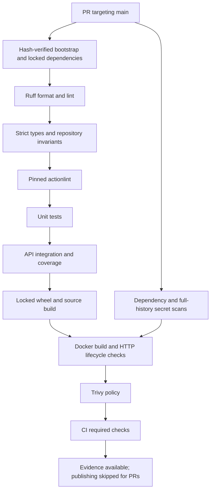

# Pipeline design

`ci.yml` runs for PRs targeting `main`, pushes to `main`, and manual dispatch. Jobs use Ubuntu 24.04 and Python 3.13, bounded timeouts, pip caching keyed by the lock, read-only default tokens, and concurrency cancellation for superseded CI runs. Release and rollback do not cancel an in-progress operation.

## Pull request validation

Quality and security run independently and must both succeed before Docker validation. `CI required checks` provides a stable aggregate status: failures or skipped mandatory jobs fail it. Publishing/staging are excluded from this PR status because they intentionally skip untrusted PRs. Main publication independently requires the quality, security, and container jobs to succeed and verifies repository, branch, event, and the owner-enabled publication variable.

| Job | Additional permissions beyond contents read | Evidence |
| --- | --- | --- |
| Quality, PR container, security | None | JUnit, coverage, packages, container smoke/logs, full scanner reports |
| Required aggregate | No token permissions | Mandatory job conclusions |
| Trusted publishing | Packages write | Validated build record, registry smoke/scan, provenance, SBOM |
| Staging | Packages read | Staging record and diagnostics |
| Release preflight | Actions read | Verified run, checksums, matching records |
| Production simulation | Actions read, packages read | Fresh scan, release record/notes, HTTP/shutdown result |
| Optional semantic promotion | Actions read, packages write | Verified tag/digest equality in logs |
| Optional draft release | Actions read, contents write | Verified owner tag and draft with evidence attachments |
| Rollback | Actions read, packages read | Rejected candidate, rescanned previous image, recovery record |

All external Actions use upstream-verified full commit SHAs. Bootstrap wheels and scanners are hash-verified. CI compares the production export with the lock. No mandatory check uses `continue-on-error`.

A failed post-publication check may leave a candidate in GHCR. Without successful build/staging records it cannot pass release preflight. Registry presence alone is not validation. CI artifacts expire after 30 days, and release evidence must be at most seven days old; rebuild/revalidate a candidate when evidence is missing or stale.
