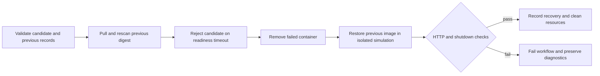

# Isolated rollback runbook

Rollback is demonstrated as recovery in an ephemeral runner environment. It is not a rollback of persistent production infrastructure. Inventory is in memory, so image recovery does not restore user-created data.

Keep the build and staging records for at least two successful registry candidates. `docs/verification.md` records observed candidates when available; the GitHub artifacts are authoritative inputs. A previous digest must come from a distinct, older successful `main` CI run with matching staging evidence, within the seven-day evidence limit.

## Demonstration

```powershell
gh workflow run rollback.yml --repo gig0d/enterprise-cicd-pipeline --ref main -f candidate_run='<newer-ci-run>' -f candidate_digest='sha256:<newer-64-hex-digest>' -f previous_run='<older-ci-run>' -f previous_digest='sha256:<older-64-hex-digest>'
```

Only `gig0d` may dispatch this workflow on `main`. It validates both CI runs and artifact checksums, pulls both images by digest, rescans the previous image under the current container policy, and starts the candidate with a purpose-built sleeping process instead of its HTTP server. Readiness must fail within a bounded timeout. The script removes that container, then starts the previous image normally, verifies its original source revision and HTTP behavior, checks clean shutdown, and removes its resources.

Inspect `rollback-evidence/rollback-record.json`, `rejected-candidate.json`, `restored-image.json`, and diagnostic logs. The workflow passes only when the controlled candidate fails readiness and the previously validated image passes recovery. A cleanup error, identical digest, newer alleged previous image, failed/stale source run, security-policy failure, or unsuccessful recovery fails the demonstration.



For an actual release incident, stop promotion, retain safe logs and both digests, investigate the failed candidate, and select a previous digest only after checking current security findings. Infrastructure-specific traffic switching, persistent storage recovery, backups, and externally hosted environments remain outside this portfolio MVP.
